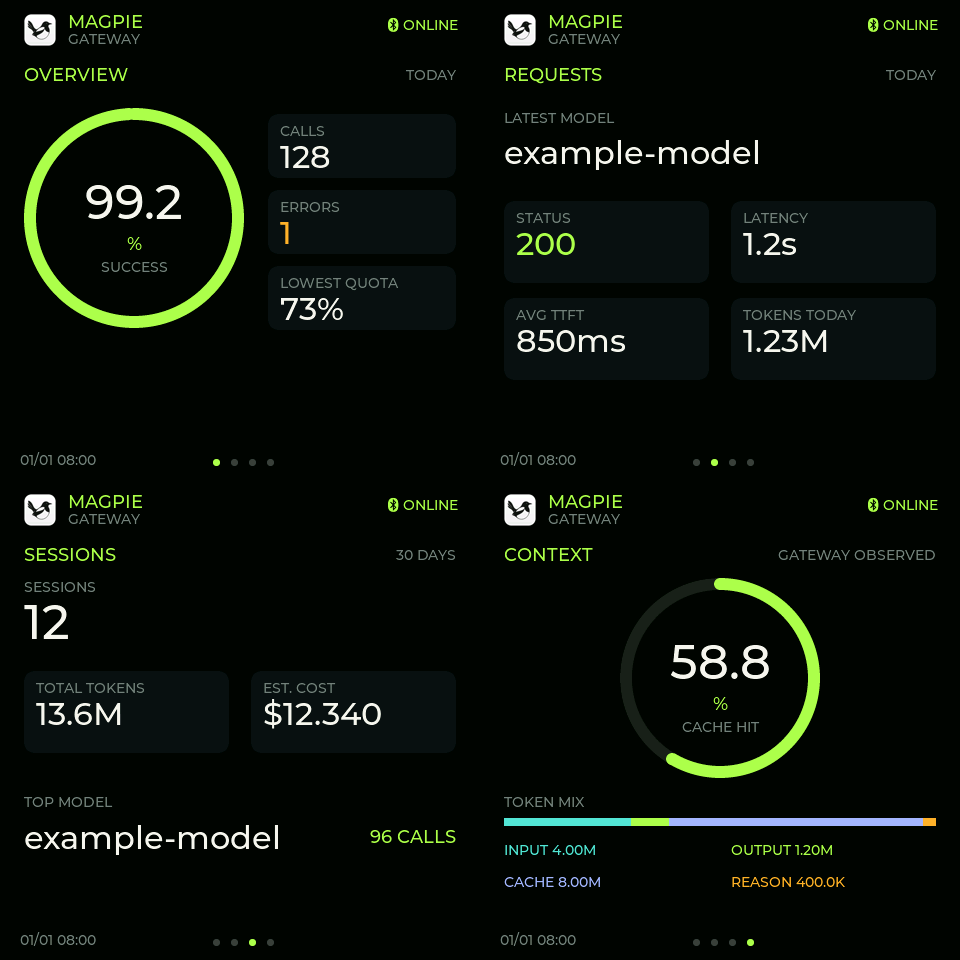

# ESP-Mosaico 验证记录

日期：2026-10-20。真机：CoreBoard v1.2 / ESP32-S31 rev v0.0 / CO5300 480×480 / CST9220。
SDK、依赖及操作步骤见[适配说明](../ports/esp-mosaico/README.md)。

| 项目 | 证据 | 边界 |
| --- | --- | --- |
| 固件构建 | 实装源码编译通过；公开前独立 checkout 从空 build 目录再次构建通过 | 依赖记录的 IDF commit 及链接补丁 |
| 写入 | 应用区写入完成，设备端哈希验证通过 | 不把写入等同于运行 |
| 设备启动 | `CO5300 ... SCLK=42 RST=44`、CST9220 芯片识别、`app: ready` | 原始设备身份已省略 |
| 蓝牙 | 首次配对成功，`encryption change status=0` | 未在所有 macOS 版本验证 |
| 数据传输 | 实装最终版本收到 seq=30、31、32 等递增数据包；后台持续发送 | 原始个人用量数据不公开 |
| 重连 | 手动进程切换后台服务、多次应用重启后自动重连，无需再次输码 | 未做完整 Mac 重启测试 |
| 实际显示 | 用户先报告黑屏、后报告色差与错位；最终修复后明确确认“正常了！很好！” | 人工观察确认，不伪称自动图像测量 |
| 触摸 | 官方驱动识别 0x9220 / 480×480，现场显示与交互确认 | 未做完整坐标精度校准 |
| 电脑端测试 | 20 项 unittest 通过，含认证等待、时限及非认证错误 | 模拟 BLE 测试不代替真机 |
| 像素格式测试 | 标准 RGB、白黑、边界和缓冲恢复通过 | SPI 物理链路仍需真机验收 |
| 软件界面 | 真实 UI 源码渲染四页，字体/布局检查通过 | 下图为合成数据的软件渲染，不是真机照片 |

## 交付前反向检查

1. **把“能连上”误当完成？** 同时检查设备实际解析的递增序列与屏幕反馈。
2. **仅在原目录偶然能编译？** 独立 checkout、空 build 目录完整构建。
3. **转换后又破坏字体/图片内存？** 只在传输边界转换，DMA 后还原，并测试还原及边界。
4. **抢走别的设备或改坏分区？** 本次按硬件身份确认同一设备，核对完整分区，只更新应用；保留本地备份。
5. **遗漏上游贡献或发布私有数据？** 保留 fork、原始许可与贡献声明；仅发布源码、文档和合成预览。

已验证构建与运行，不承诺跨板型、跨 SDK 或长期无人值守可靠性。
